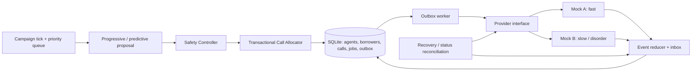
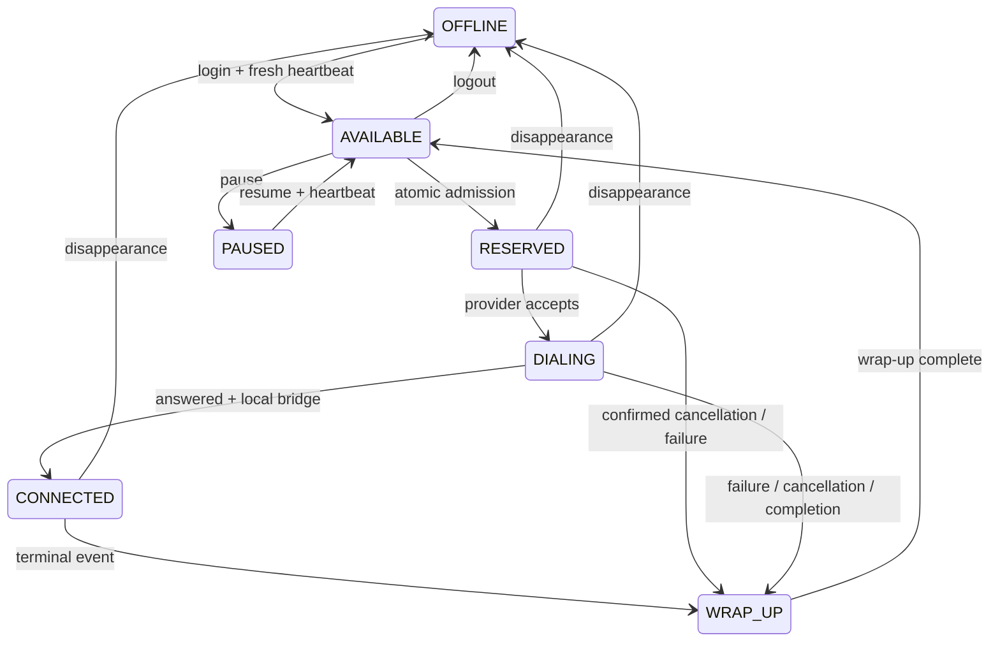
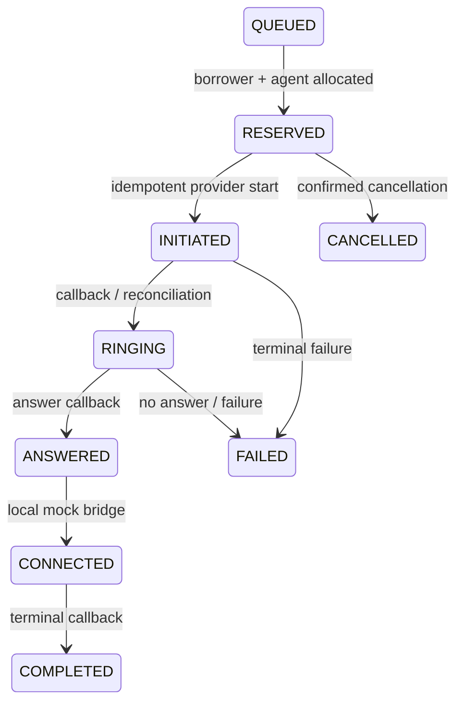

# SmartDialer: design and assignment answers

## 1. Decision and safety invariant

Choose Python plus SQLite for a small, locally reproducible prototype. Correctness is concentrated in a transactional database rather than coordinated across a cache, queue, and several services. Both pacing engines return a number; neither receives a provider reference. Only the safety-controller admission path creates durable calls and outbox commands. The worker dispatches only those durable commands.

The admission invariant is: every nonterminal call owns one distinct agent reservation and one distinct borrower reservation. Reservation occurs BEFORE a provider request. A partial unique index on each resource enforces this even if a future allocation implementation has a bug. AVAILABLE capacity excludes RESERVED, DIALING, CONNECTED, WRAP_UP, PAUSED, OFFLINE, and agents with a stale heartbeat.

This prevents abandonment caused by deliberate overbooking under the model's assumptions. It cannot guarantee that a real human, network, or bridge remains available after admission. Agent disappearance after ringing is a real residual risk. The system cancels and waits for confirmation; during a provider outage it retains the reservation. Do not call that an absolute real-world zero-abandonment guarantee.

## 2. Architecture

Safety checks and allocator writes intentionally share one database transaction; splitting them would permit a check-then-act race. In deployment, place provider credentials in the dispatch service, expose admission as its only public command, and give pacing workers no provider network access or database write role. Python classes express the boundary in this prototype; they are not a hostile-code security sandbox.

## 3. Agent state machine

OFFLINE and PAUSED are represented as states; login, heartbeat, pause, and disappearance are external control inputs, illustrated through transactional updates in tests. `wrap_up()` models the completion signal explicitly, not a real wrap-up timer. Offline agents remain offline when a call terminates. A heartbeat TTL of 30 seconds gates admission; explicit offline updates gate the next admission immediately. Run the reconciler periodically (e.g. every second) in an actual service. Recovery is invoked explicitly in this prototype.

Two workers reserving one agent: SQLite BEGIN IMMEDIATE serializes writers. Worker 1 reads capacity and writes reservations, calls, job, and outbox atomically. Worker 2 reads the committed updated state afterward. Unique active-agent and active-borrower indexes provide an additional constraint. SQLite is authoritative; a future cache must never authorize allocation.

## 4. Call state machine

QUEUED is stored on the borrower. ANSWERED and CONNECTED collapse into one atomic local transaction because the mock bridge cannot fail separately. Real bridging needs a durable bridge command, acknowledgement, timeout, and bridge idempotency key. The event reducer permits forward jumps when callbacks are missing. Terminal events can arrive from any nonterminal state; terminals are absorbing. First terminal wins. A later ANSWERED or RINGING cannot resurrect a completed call. Conflicting terminal outcomes are retained in the inbox and require a production reconciliation policy.

Deduplication has two layers: unique (provider, event_id) for transport repeats, and monotonic state reduction for semantically repeated events with different identifiers. Inbox insertion, call update, agent release-to-wrap-up, and borrower completion are one transaction. A crash rolls back all of them or preserves all of them. COMPLETED before ANSWERED remains COMPLETED; the prototype does not infer a connection metric from missing history.

## 5. Pacing calculation and safety decisions

Progressive requests A calls, where A is current available capacity. Predictive requests:

    p = clamp(estimated answer probability, 0.05, 0.99)
    expected_need = max(0, A - R * p)
    proposal = ceil(expected_need / p)

R counts initiated/ringing calls; the simulator estimates p as (answered + 2)/(resolved attempts + 4), a Beta(2,2) posterior mean. It learns only observed outcomes. This intentionally simple estimator is cumulative and adapts slowly after a regime change. Production should use bounded recent windows or exponential decay, sample-size checks, provider segmentation, and a rate-of-change limit.

Example: A=5, R=0, p=0.30 gives ceil(5/0.30)=17. Safety approves at most 5 because all 17 could answer together. Talk time changes when agents become available in the simulation, but is not used to pre-reserve hypothetical future capacity. Provider setup latency consumes reserved time. Uncertainty is handled by falling back to a strict capacity cap, rather than asserting a statistical confidence interval gives deterministic safety.

Safety approves, reduces, or rejects based on live transactional agent availability, borrower supply, heartbeat age, provider breaker, and a maximum batch of 100. It never trusts the pacing engine's A value. Provider degradation rejects new work; low answer probability cannot expand admitted capacity. With a fresh available agent and no queued eligible borrower, no call is admitted.

The included simulation shows that a predictive proposal does not automatically create a utilization gain. Under these constraints it generally equals progressive or can underfill because outstanding ringing calls reduce its proposal. That result is a useful consequence of insisting on deterministic resource reservations, rather than a benchmark to hide.

## 6. Provider contract and failure handling

MockProvider supports start(idempotency_key), status(key), cancel(key), and simulator event/sample methods. Mock A uses one-second setup and the configured answer probability. SlowProvider (B) adds 5-10 second setup, a 12% failure probability, duplicate events, late ringing events, and a simulated outage at seconds 300-329. Timeout injection is a toggle on the adapter; no real-time sleeps or telecom calls occur.

A persistent provider ledger models the external provider's idempotency guarantee. Retrying the same start key creates one remote call. Cancellation leaves a tombstone even when start has not arrived, so a delayed start cannot recreate a cancelled call. A real integration must verify these semantics with its provider; without provider idempotency and lookup, exactly-once remote initiation cannot be claimed.

Worker crash after reserve: durable outbox survives, another worker dispatches it. Crash after the provider accepted but before local acknowledgement: retry uses the SAME call ID, then status reconciliation restores progress. Never create a fresh call identifier just because a request timed out. Crash after ANSWERED: local bridge/state transaction is atomic; COMPLETED later closes the same call and releases its resources once.

Provider outage: on timeout, open a 10-second breaker. New admissions for that provider stop; pending commands remain durable, existing calls keep their reservations, and callbacks can still be applied. A later dispatch after cooldown probes with the same key. Repeated failure reopens the breaker. This minimal breaker has a fixed cooldown, not a coordinated single-probe half-open state. Production needs jittered exponential backoff, bounded probe ownership, attempt limits, and operations escalation. Do not fail over an ambiguous call to another provider: both might ring.

Agent loss: admission sees explicit OFFLINE immediately or heartbeat staleness within 30 seconds. Recovery cancels setup calls and applies CANCELLED only after cancellation/status confirmation. Unknown remote outcome means held capacity, never automatic lease-expiry release. If 40 of 100 available agents disappear before allocation, only 60 calls can be admitted. If they disappear after allocation, cancellation and reconciliation are required. Disappearance during an active conversation is a separate operational failure, not safe capacity to reuse.

## 7. Borrower eligibility and dataset use

The supplied archive describes itself as an analytics challenge dataset and includes duplicates, missing fields, mixed timezones, inconsistent identities, and conflicting events. It does not establish current contact eligibility. The prototype therefore uses synthetic IDs and deterministic descending priority; it does not dial the supplied phone numbers or infer active agent availability from historical sessions.

The included profiling report counts rows, blank IDs, repeated IDs, and call statuses. Primary-key whitespace is trimmed for that audit. The profiling status view keeps the last physical row per call only to describe raw data; it is NOT a trusted answer-rate training set.

Before operational import: canonicalize IDs with explicit mappings, quarantine conflicting duplicates, normalize timestamps using source timezone and reject ambiguities, join borrower/account/campaign validity, filter eligible channel/contact windows and suppression/complaint rules, and distinguish answered from agent-connected and completed. Keep event-time and ingestion-time separately. Never resolve all dirty data with an indiscriminate drop_duplicates. A real retry queue needs contact limits, cooldowns, opt-out checks, and durable eligibility decisions. Here, terminal attempts mark borrowers DONE; retries in this implementation mean transport retries of the same attempt, not repeated collection contacts.

## 8. Tests, simulation, load test

Tests exercise independent database connections across competing threads, unique reservations, duplicate jobs, crash/restart with persistent provider state, duplicate and late callbacks, terminal-first ordering, outage admission gating, offline cancellation, stale heartbeat, and loss of 40 agents. This is a local multi-worker concurrency demonstration, not proof of multi-host operation.

Simulation runs 50 agents, 30,000 synthetic borrowers, 900 virtual seconds, random seed 42, both modes and both providers:

| Scenario | Answer probability | Talk duration |
|---|---:|---:|
| A | 20% | 120 seconds |
| B | 50% | 90 seconds |
| C | 70% | 180 seconds |
| D | 70% then 10% at midpoint | 90 then 180 seconds |

Metrics: initiated calls, connections observed before the horizon, connected agent-seconds / total staffed agent-seconds, total requests, approvals, reduction ticks, and sampled decision explanations. No post-horizon drain is included. Wrap-up is immediate in this simplified simulation; production utilization must account for real wrap time. The simulation is a demonstration, not an unbiased forecast from the supplied dataset.

Load test: 8 concurrent workers allocate from 100, 1,000, and 10,000 fresh agents. It asserts every agent is allocated once and every borrower is distinct. Included measured timings describe this machine and SQLite storage only. It does not measure callback throughput, long-running campaigns, network delay, or requests per second supported in production.

## 9. Architecture decision record and scaling

Decision: one relational database and transactional outbox. Benefit: atomic admission and recovery are inspectable; no cache consistency problem or broker setup. Cost: SQLite serializes all writers, has no row-level SKIP LOCKED, and is unsuitable for a multi-host dialer. Store.tx also uses write transactions for reads for simplicity; this increases contention.

At 100 agents, this design is a reasonable local prototype. At 1,000, event write contention and repeated capacity scans become visible, depending on call rate. At 10,000, shared write serialization, outbox polling, event retention, and provider quotas will constrain latency before CPU alone does. The benchmark only measures initial allocation, so it cannot identify the exact live-traffic saturation threshold.

Migration: use PostgreSQL; claim eligible agents and borrowers with SELECT FOR UPDATE SKIP LOCKED in one transaction, preserve unique active-resource constraints, and use a durable per-campaign admission budget when multiple partitions share an agent pool. Claim outbox work with leases and fencing tokens. Provider idempotency remains essential because a lease cannot revoke an in-flight network call.

Index queued borrowers by campaign/eligibility/priority; index pending outbox entries and active calls; partition/archive inbox history. Batch writes while bounding lock hold time. Partition campaigns by skill-compatible agent pool so most admission does not contend globally. Treat provider rate limits as another independently enforced budget. Use caches only for hints and dashboards. At 100,000 agents, shard pools with explicit ownership and bounded cross-pool transfers; arbitrary global concurrent allocation recreates the same coordination bottleneck.

## 10. Technical discussion answers

- Database AVAILABLE vs cache RESERVED: database is authoritative, but allocation still checks and writes in one transaction. Invalidate/rebuild the cache; never allocate from it.
- ANSWERED, crash, COMPLETED: transactional inbox reduction preserves CONNECTED or rolls it back entirely; terminal event safely closes it. If events arrive reversed, terminal wins.
- Answer rate drops from 70% to 10%: proposals eventually rise, but safety still allows at most real reserved capacity and provider/batch limits. Utilization falls; capacity safety remains. Add a recent-window change detector for faster adaptation.
- Why 17 instead of 10: proposal formula and observed rate explain the requested count; the live capacity check separately explains the approved count. Both appear in simulation traces.
- Least confident area: real provider/bridge semantics and agent disappearance between admission and actual answer. The local mock cannot establish an absolute external safety guarantee.
- Another week: real bridge outbox, eligibility policy, authenticated callback adapter, provider sequence reconciliation, bounded retry scheduler, PostgreSQL process-level stress tests, and operational metrics before any real dialing.

## 11. Final question: predictive utilization with progressive safety

Reserve a unique, live, skill-compatible agent before every admitted call, and keep that reservation until a confirmed terminal outcome. Let prediction optimize borrower ordering, provider choice, setup timing, and readiness preparation; let the independent safety controller own admission and resource reservations. Use warm agent connections and fast bridging to reduce setup waste.

Do not count an agent predicted to finish soon as guaranteed available. If calls are started without reserved agents, simultaneous answers can exceed capacity even when the average forecast is accurate. Greater utilization from overbooking therefore requires an explicitly accepted abandonment risk or a genuinely guaranteed alternative answering resource. Under strict one-agent-per-call safety, accept a utilization ceiling and optimize the time spent inside it.

Simulation storage note: virtual-time runs reuse one local SQLite connection with synchronous=NORMAL and an in-memory remote ledger to avoid disk-latency artifacts. Crash recovery tests use the persistent mock-provider ledger and independent worker connections. These simulation shortcuts are not a durability benchmark.
